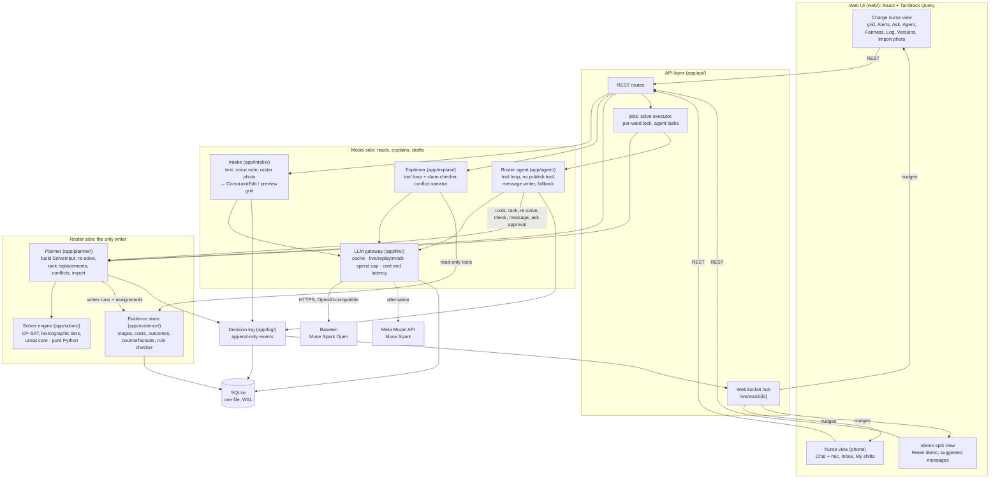

# Architecture

ShiftSense is one FastAPI process. It serves the REST API, the WebSocket and the built React app,
runs the OR-Tools CP-SAT solver in-process, and calls Meta's Muse Spark models over HTTPS. All
state lives in one SQLite file. A deploy is one container (Docker on Railway, with a volume for the
database), so nothing can fail between services during a live demo. The design is in
[`DESIGN.md`](DESIGN.md) section 3; the reasons for choices made while building are in
[`decisions.md`](decisions.md).

## The rule that shapes everything

**The language model never edits the roster.** Muse Spark reads messages, voice notes and photos,
calls read-only tools, explains results and drafts messages. Only CP-SAT writes assignments, and
only a person publishes. In the diagram, model calls flow down the left two columns; the roster is
written only down the right-hand column, from the planner through CP-SAT into the evidence store.
The explainer and the roster agent reach the evidence through tools and never call the solver to
write.

How the rule is enforced in code, not only by convention:

- `app/solver/` imports nothing from the web, LLM or database layers (`tests/test_boundaries.py`
  scans the imports).
- The intake model returns a `ConstraintEdit` (a closed set of operations); code resolves names
  and dates, checks the quoted evidence, never lets the model set `hard`, and writes the
  confirmation from a template. Nothing reaches the solver until the sender taps Confirm.
- The roster agent's tool registry has no publish tool and no tool that writes a run's status;
  `tests/unit/test_agent.py` checks the registry and scans every agent module for calls to
  `publish`. Publishing happens only through `POST /api/runs/{id}/publish` (a person's click) or
  the photo import (a person's click on Import).
- Every factual sentence in an explanation is a claim that cites a tool result by path and value;
  the claim checker rejects answers whose claims do not match, and a deterministic explanation
  from the same results replaces an answer that fails twice.

## Components

| Component | Package | Responsibility |
| --- | --- | --- |
| Web UI | `web/` | Charge nurse view, nurse view (mobile first), `/demo` split view |
| API layer | `app/api/` | REST routes, WebSocket hub, background solves and agent tasks, demo reset |
| Intake | `app/intake/` | Text and voice-note transcripts → validated `ConstraintEdit` → template confirmation; roster photo → preview grid |
| Solver engine | `app/solver/` | CP-SAT model (hard rules, soft terms in priority tiers), lexicographic solve, minimal-change re-solve, unsat core, independent validator |
| Planner | `app/planner/` | Runs: full solves, re-solves from the published roster, sick-call ranking, conflict options, request lifecycle, photo import, versions |
| Evidence store | `app/evidence/` | Stage, cost, request-outcome and fairness rows per run; counterfactual re-solves ("what if Priya took it?"); rule checker |
| Explainer | `app/explain/` | Muse Spark tool loop over evidence tools, claim checker, deterministic fallback, conflict narrator |
| Roster agent | `app/agent/` | Muse Spark runs sick calls, conflicts, leave, swaps and new periods with tools; pauses for nurse replies and charge-nurse approval; fixed-code fallback |
| LLM gateway | `app/llm/` | One interface over Baseten, the Meta Model API and an optional Modal endpoint, plus a rule-based mock; content-addressed cache; cost, latency and reasoning logged per call |
| Decision log | `app/log/` | Append-only events (messages, parses, solver stages, proposals, approvals, publishes) |
| Eval harness | `evals/` | Fixed eval sets per role, code-only scoring, reports, sick-call statistics |

## A sick call, end to end

1. Meena types (or records) *"Sunita di, aaj subah ki duty nahi kar paungi, bukhar hai"* in the
   nurse view → `POST /api/messages`. A voice note is transcribed by Muse Spark Open first.
2. Intake builds the prompt (calendar, shifts, nurse list, open requests), calls Muse Spark Open
   through the gateway (cache first), validates the JSON, repairs once if needed, then checks the
   nurse, dates, shift and evidence in code. The reply is a template: "Aapko 3 Nov (Mangalvaar) ki
   Morning duty se hata diya jayega. Confirm karein?"
3. Meena taps Confirm → `POST /api/requests/{id}/confirm`. The request becomes active and hard, a
   minimal-change re-solve starts in the solve executor, and the roster agent takes over the
   workflow.
4. The planner freezes everything before now, keeps the published roster as the previous
   solution (every changed cell costs in the stability tier), filters candidates with the rule
   checker, and runs up to six forced re-solves in parallel, one per candidate. Candidates are
   ranked by tier vector; the top one's run is the proposal. On the demo ward this takes about
   half a second.
5. The agent reads the ranking through tools, writes a claim-checked summary, and asks the charge
   nurse for approval. The WebSocket nudges every open view, which refetch over REST.
6. The charge nurse asks "Why Arun and not Priya?" (`POST /api/explain`): the explainer calls the
   evidence and counterfactual tools, and every claim is checked before the answer is shown.
7. The charge nurse approves → the proposal is published. The agent drafts the ask to Arun in
   Hindi (checked for date, shift and health words, with a template fallback) and waits for his
   reply in his inbox; a decline makes it re-rank without him.

Every step is an event in the decision log, shown in the Log tab and per task in the Agent tab.

## Models and providers

| Role | Model (live default) | Output contract | Checked by |
| --- | --- | --- | --- |
| Intake | Muse Spark Open on Baseten | `ConstraintEdit` JSON | Pydantic schema, then semantic validation in code |
| Voice | Muse Spark Open (audio input) | transcript text | Then the intake path |
| Vision | Muse Spark Open (image input) | roster grid JSON | Code: vocabulary, name mapping, printed-totals checksum; a person corrects the preview |
| Explain | Muse Spark Open, tool calling | answer + claims | Claim checker against tool results |
| Narrate | Muse Spark Open | summary + option labels | Checked against the option list |
| Message | Muse Spark Open | message text | Date, shift, length, health-word blocklist |
| Agent | Muse Spark Open, tool calling | tool calls | Per-workflow allowlist, budgets, approval rules |

The Meta Model API (Muse Spark) is configured from `META_BASE_URL`, `META_MODEL` and `META_API_KEY`
and can take any role (`LLM_PROVIDER_*`). The `openai` Python package is used only as the HTTP
client for these OpenAI-compatible endpoints (class `OpenAICompatProvider`); no OpenAI or other
non-Meta model is ever called. Muse Spark Open always reasons before answering; the gateway keeps
the reasoning in `llm_call` for the Log and parses only the final content and tool calls.

**Modes.** `LLM_MODE=live` calls the model on a cache miss and stores the answer; `replay` serves
only cached answers and needs no keys (the committed `data/llm_cache.jsonl` covers the scripted
demo and the eval sets); `mock` is a rule-based stand-in for tests and UI work. The cache key is a
hash of provider, model, role, messages (images and audio by their sha256), tools, schema and the
role's prompt files, with run ids replaced by placeholders.

## Data

SQLite (`app/store/schema.sql`) holds the ward, nurses, history, requests, runs (with parent run,
kind, status and the exact `SolveInput`), assignments with change causes, stages and costs per
run, request outcomes, counterfactuals, conflicts, proposals, agent tasks, nurse messages, the
event log, every LLM call and the response cache. Runs form a tree: the planned run (the seed
solve, or an imported paper plan) is the root, and each published proposal is a child of the run
it changed. The Versions tab diffs the planned run against the current one.

## Concurrency

- One Uvicorn worker: SQLite and the in-memory WebSocket hub assume one process.
- Solves run in a two-thread executor so the event loop keeps serving WebSockets; CP-SAT releases
  the GIL. A per-ward `asyncio.Lock` serialises solves that write runs, publishes, imports and
  demo resets. Counterfactual re-solves run in parallel and write only their own table.
- Roster-agent tasks are asyncio tasks with a lock each; demo reset cancels them before restoring.
- CP-SAT workers come from `SOLVER_WORKERS` (8 locally, 4 on Railway).

## Deployment

`Dockerfile` builds the web app and the Python environment (`uv sync --frozen`) into one image;
`railway.toml` sets the health check (`/api/health`). The Railway service mounts a volume at
`/data` for the database and solver logs. An empty database seeds itself (`SEED`); the mini ward
loads its committed solved baseline so every deployment starts from the same roster as the
committed cache. `POST /api/demo/reset` restores that baseline in under a second.

## Tests

`make test`: ruff, ruff format, mypy and pytest in mock mode (no network): hard-rule tests against
the independent validator, the mini ward's proven golden tiers, re-solve and ranking, intake,
explainer, agent and API tests, and replays of the recorded live answers. `make e2e`: Playwright
runs the demo script on `/charge`, `/nurse` and `/demo`, including reset, phone width, the voice
chip and the photo import. `make reference`: the reference CP-SAT model and golden tests the solver
was built against.
